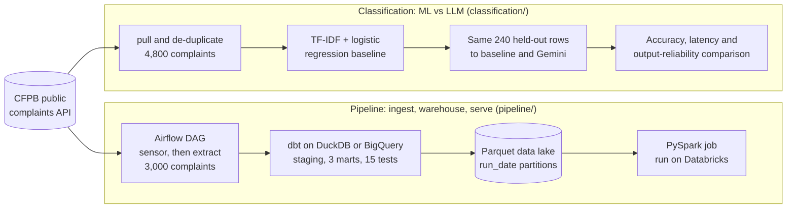

# Consumer Complaint Analytics

Two projects on the same real dataset (live CFPB consumer complaint data), previously separate repositories, consolidated here (with full commit history preserved via `git subtree`) to tell the actual end-to-end story: ingest and warehouse the data, then classify it.

## How the pieces fit

Both projects start from the same public CFPB complaints API, but they run independently: each does its own pull (3,000 complaints for the pipeline, 4,800 sampled evenly by category for the classifier) and neither reads the other's files. The detailed flow diagrams are in [`pipeline/`](pipeline/) and [`classification/`](classification/); the Airflow DAG has its own in [`pipeline/orchestration/`](pipeline/orchestration/).

## [Pipeline](pipeline/) — dbt, DuckDB, BigQuery, Airflow, Spark & Databricks

Ingests live CFPB complaint data through a tested dbt pipeline: staging models dedupe templated/mass-filed complaints and catch data-integrity issues (15 automated tests), rolling up into 3 dimensional marts with a [generated docs site](https://saijignas.github.io/Consumer-Complaint-Analytics/pipeline/docs/) showing full model lineage. The same models build against both **DuckDB** and **Google BigQuery**, with matching results across both engines. Orchestrated end-to-end by an [Airflow DAG](pipeline/orchestration/) — sensor, extract, `dbt run`/`dbt test`, then export to a `run_date`-partitioned Parquet data lake, which a [PySpark job](pipeline/spark/) queries directly, verified with a real run on **Databricks** serverless compute.

## [Classification](classification/) — ML vs. LLM

Classifies the same complaint data into product categories: a classical TF-IDF + logistic regression baseline (macro-F1 0.84, cross-validated and held-out) benchmarked against zero-shot Gemini classification on identical held-out rows, comparing accuracy, latency, and output reliability rather than picking a single "best" model.

---

Each subdirectory is self-contained with its own README, dependencies, and test suite — see the linked READMEs above for setup instructions and full results.
